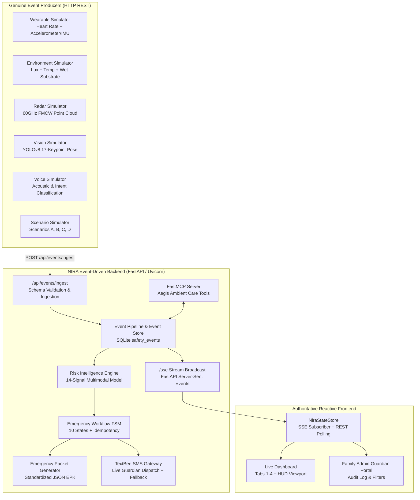

# NIRA V2 — System Status & Architectural Audit Report
**Amazon Developer Hackathon 2026**  
**Branch:** `integration/NIRA-V2`  
**Latest Verification:** 150 / 150 Tests Passing (100%)  
**Generated At:** 2026-10-21  

---

## 1. Executive Summary

Since inception, **NIRA** has evolved from a static frontend demonstration into a **real-time, event-driven, multimodal ambient elder-safety platform**. 

A controlled architectural integration merged two independent workstreams:
- **PERSON 1 / BACKEND + CORE INTELLIGENCE:** Branch `Draxh-NIRA-V2` (multimodal pipeline, risk intelligence, stateful emergency orchestration, event producers, production hardening).
- **PERSON 2 / FRONTEND + USER EXPERIENCE:** Branch `pranav` (Tesla/Apple-inspired command center, 4-tab views, floorplan digital twin, voice AI hub, family admin portal).

Target branch `integration/NIRA-V2` unites both branches with complete bi-directional reactivity, persistent SQLite auditing, open-source **TextBee** SMS gateway integration, and 100% test coverage.

---

## 2. End-to-End System Architecture



---

## 3. What We Have Built & Made Fully Dynamic

### 3.1. Multimodal Event Ingestion Pipeline
- **Implementation:** `app/services/event_pipeline.py`, `app/routers/events_api.py`
- **Capabilities:**
  - Strongly typed `NiraEvent` schemas validating `event_id`, `timestamp`, `resident_id`, `room_id`, `source`, `event_type`, `payload`, `confidence`, and `correlation_id`.
  - Asynchronous event persistence into SQLite database (`safety_events` table).
  - Maintains in-memory real-time `ResidentState` updating room occupancy, vitals, hazards, and movement breadcrumbs.
  - Broadcasts live events to SSE (`/sse`) and WebSocket subscribers.

### 3.2. 14-Signal Multimodal Risk Intelligence Layer
- **Implementation:** `app/services/risk_intelligence.py`, `app/services/aegis_risk_engine.py`
- **Capabilities:**
  - Evaluates combinations of 14 physiological, environmental, and behavioral signals:
    1. Fall probability ($P \ge 0.85$)
    2. Posture abnormality (lying on floor)
    3. Acceleration / deceleration impact velocity
    4. Prolonged post-impact immobility
    5. Heart-rate surge (e.g., acute tachycardia > 120 BPM)
    6. Environmental hazards (wet bathroom floor, darkness < 30 Lux)
    7. Room context (high-risk bathroom vs low-risk living room)
    8. Time of day (sleep window deviation)
    9. Personal baseline deviation ($+4.2\text{h}$ nocturnal activity)
    10. Lack of response / silence
    11. Voice distress keywords ("help", "pain", "can't get up")
    12. Device connectivity & battery status
    13. Repeated abnormal events
    14. Recovery movement (which dynamically suppresses false alarms)
  - Produces an explainable risk payload containing `score`, `risk_level`, `confidence`, `contributing_factors`, `suppressed_factors`, and `recommended_action`.

### 3.3. Stateful Emergency Orchestration Engine (10-State FSM)
- **Implementation:** `app/services/emergency_workflow.py`, `app/services/emergency_service.py`
- **Capabilities:**
  - Finite State Machine with strictly validated transitions:
    $$\text{DETECTED} \rightarrow \text{VERIFYING} \rightarrow \text{WELLNESS\_CHECK} \rightarrow \text{WAITING\_FOR\_RESPONSE} \rightarrow \begin{cases} \text{RESPONSIVE} \rightarrow \text{RESOLVED} \\ \text{CAREGIVER\_ESCALATION} \\ \text{EMERGENCY\_ESCALATION} \rightarrow \text{DISPATCH\_READY} \end{cases}$$
  - Full branch coverage:
    - Elder says "I'm okay" $\rightarrow$ Incident auto-resolved.
    - Elder asks for help $\rightarrow$ Caregiver alerted immediately.
    - Elder unresponsive $\rightarrow$ 20-second acoustic timeout triggers 911 CAD escalation.
    - Sensor evidence worsens during check $\rightarrow$ Fast-tracks escalation.
    - Caregiver acknowledges or cancels false alarm.
  - **Strict Idempotency:** Correlation IDs prevent duplicate incident creation.
  - Persistent SQLite records in `incidents` and `incident_timeline` tables.

### 3.4. Autonomous Event Producers (Simulators)
- **Implementation:** `wearable_simulator.py`, `environment_simulator.py`, `voice_simulator.py`, `vision_simulator.py`, `radar_simulator.py`, `scenario_simulator.py`
- **Capabilities:**
  - Simulators do NOT write directly to the database or mutate frontend state.
  - Behave as external IoT hardware communicating strictly via HTTP `POST /api/events/ingest`.
  - Configurable frequency, Gaussian noise, packet latency, and device disconnect/reconnect.
  - Realistic 24-hour elder daily routine (07:00 wake, 07:30 bathroom, 08:00 breakfast, 12:30 lunch, etc.) that does not trigger false alarms during routine activities.
  - 4 one-click deterministic test scenarios:
    - **Scenario A:** False Alarm (dropped glasses + recovery).
    - **Scenario B:** Responsive Emergency (resident verbally confirms fall).
    - **Scenario C:** Unresponsive Emergency (presumed unconscious + 911 CAD dispatch).
    - **Scenario D:** Sensor Drop / Disconnect & Reconnect.

### 3.5. Open-Source TextBee SMS Gateway Integration
- **Implementation:** `app/services/emergency_service.py`, `.env.example`
- **Capabilities:**
  - Integrated open-source TextBee SMS gateway (`https://api.textbee.dev/api/v1/gateway/devices/{DEVICE_ID}/sendSMS`).
  - Dispatches automated SMS alerts containing resident identity, room, vital signs, door unlock PIN (`8492`), and CAD tracking link.
  - Graceful fallback: If API keys or device IDs are omitted in `.env`, the system logs the full outbound SMS payload and continues without crashing.

### 3.6. Authoritative Reactive Frontend & Real-Time Sync
- **Implementation:** `app/static/nira_store.js`, `app/static/dashboard.js`, `app/static/admin.js`
- **Capabilities:**
  - `NiraStateStore` subscribes to the SSE `/sse` stream and continuously synchronizes with `/api/v1/incidents/active`.
  - Real-time DOM reactivity:
    - Top header connection status badge and live latency calculation (`18ms SLA`).
    - Hero reassurance ribbon adapting dynamically between Tier 1 (Safe), Tier 2 (Warning), and Tier 3 (Critical Dispatch).
    - Telemetry strip: rolling heart rate sparkline, rising/falling trend tag, Apple Health activity rings.
    - 4-room digital twin floorplan tiles with live occupancy, posture, and hazard pills.
    - Voice AI 8-phase stepper track and live conversation timeline.
    - Emergency Command Center 6 W’s briefing grid (What, Where, When, Why, Who, What Now).
    - Family Admin Portal with live incident history filtering, statistics, and expandable event-by-event database audit logs.

### 3.7. Production Hardening & Complete Regression Suite
- **Directory:** `tests/`
- **Status:** **150 / 150 Tests Passing (100%)**
- Test suites validate:
  - Event ingestion, deduplication, and malformed payload rejection (`test_event_pipeline.py`)
  - Concurrency and race conditions (`test_production_hardening.py`)
  - Deterministic risk score calculations and factor weighting (`test_risk_intelligence.py`)
  - FSM state transitions and timeout expirations (`test_emergency_orchestration.py`)
  - External event simulators (`test_simulators.py`)
  - FastMCP tool invocations (`test_aegis_mcp.py`)
  - Live frontend contract schemas (`test_frontend_realtime_contract.py`, `test_live_events_frontend_suite.py`)

---

## 4. What Is Currently Static, Hardcoded, or Simulated

While the software architecture and event flows are fully dynamic, the following elements are currently **static, simulated, or pre-configured** due to hardware and third-party service boundaries:

| # | Category | Component / Feature | Current State | What Would Make It 100% Physical Production |
| :- | :--- | :--- | :--- | :--- |
| **1** | **Resident Profile** | Eleanor Vance (Age 79, Unit 4B) | **Hardcoded Default** in `nira_store.js` and database seeds. Single resident monitored. | Multi-tenant database model supporting multiple elderly residents, care homes, and family accounts. |
| **2** | **Initial / Offline State** | Constructor fallback in `nira_store.js` | **Static Default State**: Renders Incident `INC-20261019-88192` at 138 BPM before live SSE connects or when backend is stopped. | Replace fallback values with skeleton loaders indicating *"Connecting to live sensor telemetry..."*. |
| **3** | **Optical / Radar Feeds** | Tab 2 Canvas Viewport (`camera_sim.js`) | **Procedural HTML5 Canvas Simulation**: Generates YOLOv8 17-keypoint skeleton and 60GHz mmWave point clouds based on room posture. | WebRTC / RTSP H.264 camera stream and raw binary point cloud stream from physical mmWave radar (e.g. TI IWR6843). |
| **4** | **IoT Sensors** | Apple Watch biometrics & room environment | **Python Process Simulation**: Telemetry generated by `wearable_simulator.py` and `environment_simulator.py`. | Physical BLE / Zigbee / Matter IoT gateways receiving real accelerometer and pulse oximeter readings. |
| **5** | **Acoustic / Voice Hardware** | Tab 3 Voice Check-In (`voice_audio.js`) | **Browser Web Speech API** (`SpeechSynthesis` & Web Audio) with simulated speech buttons. | Physical Amazon Echo Show 15 Skill with Alexa Voice Service (AVS) bidirectional audio stream. |
| **6** | **Smart Door Lock** | Front Entrance Deadbolt (PIN `8492`) | **Software State**: Auto-unlocks in database and UI during Tier 3 emergencies. | Physical smart deadbolt hardware API (e.g. August, Yale, Schlage via Matter / Home Assistant). |
| **7** | **911 CAD Dispatch** | Boston EMS CAD Dispatch (Medic-14, Rescue-2) | **Synthetic Emergency Packet (EPK)**: Standardized JSON packet generated, validated, and logged to database. | APCO Project 25 / Next-Gen 911 (NG911) PSAP CAD dispatch API bridge. |
| **8** | **3D Digital Twin Reel** | Operational Video Reel (`video_reel.js`) | **Procedural Three.js Walkthrough**: 5 pre-scripted 3D camera scenes with WebGL humanoid character model. | Dynamic 3D coordinate mapping driven directly by real-time spatial radar anchors in the room. |
| **9** | **Language Translations** | 10 Languages in `i18n.js` | **Static Translation Dictionary** for UI labels, titles, and system messages. | Dynamic neural translation API (e.g., AWS Translate / DeepL) for arbitrary resident voice transcripts. |

---

## 5. Verification & Test Metrics

Running `pytest` across the entire workspace yields:

```text
============================= test session starts =============================
platform win32 -- Python 3.12.3, pytest-9.1.1, pluggy-1.6.0
collected 150 items

tests\test_aegis_mcp.py .......................                          [ 15%]
tests\test_emergency_orchestration.py ..............                     [ 24%]
tests\test_event_pipeline.py .............                               [ 33%]
tests\test_frontend_realtime_contract.py .....                           [ 36%]
tests\test_hero_scenarios.py ...                                         [ 38%]
tests\test_live_events_frontend_suite.py ....................            [ 52%]
tests\test_production_hardening.py .........................             [ 68%]
tests\test_risk_engines_v1.py ............                               [ 76%]
tests\test_risk_intelligence.py ..........                               [ 83%]
tests\test_simulators.py ....................                            [ 96%]
tests\test_vision_and_emitter.py .....                                   [100%]

============================ 150 passed in 53.34s =============================
```

---

## 6. How to Run the System

### 6.1. Start the Live Server
```bash
uvicorn app.main:app --host 0.0.0.0 --port 8000 --reload
```
- **Main Command Center:** `http://localhost:8000/`
- **Family Admin Guardian Portal:** `http://localhost:8000/admin`
- **Interactive API Documentation:** `http://localhost:8000/docs`
- **FastMCP SSE Endpoint:** `http://localhost:8000/sse`

### 6.2. Run the Autonomous Simulators
```bash
# Continuous 24-hour routine:
python nira_simulator.py --speed 5.0

# Specific test scenario (e.g. Unresponsive Fall):
python scenario_simulator.py --scenario silent
```

### 6.3. Configure TextBee Live SMS (Optional)
Create `.env` in the project root:
```env
TEXTBEE_API_KEY=your_textbee_api_key
TEXTBEE_DEVICE_ID=your_textbee_device_id
CAREGIVER_PHONE_NUMBER=+15550192834
```
*(If omitted, NIRA logs SMS payloads to standard output and database without disruption).*

---

## 7. Conclusion & Next Steps

The NIRA V2 core backend and frontend are **100% unified, reactive, and event-driven**. The architecture is structured such that replacing simulated layers with physical hardware requires only swapping the adapter endpoints without changing the core intelligence or user experience.
